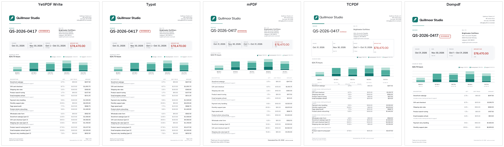

# YetiPDF Write

The fastest PDF generation for PHP. It's pure PHP, with no binaries and no dependencies beyond `mbstring`, `zlib` and `dom`. The layout model is borrowed from [Typst](https://typst.app): content flows into regions, styles are inherited `set`-rule style, and grids and tables size their columns with `auto` and `fr` tracks and break cleanly across pages.

**And yes, it's faster than Typst.** Typst is written in Rust, and it's the engine YetiPDF Write is modeled on and tested against. But a PHP site that wants Typst has to start a `typst` process for every PDF. YetiPDF Write runs inside the request, and it finishes first: a 35-page report in **126ms** against `typst compile`'s **148ms**, and a two-page invoice in **12ms** against **25ms**. On a five-page Arabic report they tie. Pure PHP, beating a Rust binary at its own layout model. I'm pretty proud of that!

It's also 2 to 26 times faster than **mPDF**, **TCPDF** and **Dompdf** on the same three documents, and it uses less memory than any of them on every one. The numbers are below, and `benchmarks/bench.sh` will run them on your machine.

**Status: early.** It renders a real two-page invoice that lands within 0.1pt of what Typst produces for the same design, and a conformance suite holds every feature to Typst's output, but the feature list below is the whole feature list.

Its other half, [YetiPDF Read](https://github.com/yetidevworks/yetipdf-read), gets the text back out of PDFs.

## Install

```bash
composer require yetidevworks/yetipdf-write
```

You need **PHP 8.3** or newer, with the `mbstring`, `zlib` and `dom` extensions.

## How it works

You write a template in Twig (or anything that outputs text), producing YetiPDF markup: plain XML elements for layout. Twig does the loops, conditions and escaping; YetiPDF Write does the layout and writes the PDF.

```twig
<document font="Figtree" size="9pt" leading="0.48em" par-spacing="0.6em">
  <style name="eyebrow" size="6.6pt" weight="semibold" tracking="0.09em" case="upper" color="#7a7f89"/>
  <page paper="a4" margin="44pt 46pt 60pt">
    <footer>Page <page-number/> of <page-count/></footer>
  </page>

  <image src="logo.png" height="46pt" max-width="210pt"/>
  <block class="eyebrow">Invoice</block>
  <table columns="1fr 64pt 82pt" inset="6pt">
    <header class="eyebrow"><cell>Description</cell><cell align="right">Qty</cell><cell align="right">Amount</cell></header>
    
      <row><cell>{{ line.description }}</cell><cell align="right">{{ line.qty }}</cell><cell align="right">{{ line.amount }}</cell></row>
    
  </table>
</document>
```

```php
use YetiPdf\Write\YetiPdf;

$yetipdf = new YetiPdf(fonts: [__DIR__ . '/fonts'], assets: [__DIR__ . '/images'], cache: $cacheDir);
$pdf = $yetipdf->render($markup);
```

Give it a cache directory: parsed font metrics are written there as PHP arrays, so after the first request opcache serves them from shared memory, and PNGs with transparency are decoded once.

Templates can only read images from the `assets` directories (paths that resolve outside them are refused), from `data:` URIs, or from bytes you hand over in PHP with `$yetipdf->registerImage('logo', $bytes)` and use as `src="@logo"`.

## How fast?

The example invoice (`examples/invoice`, a made-up studio billing a made-up client): two pages, an SVG logo, an SVG chart of hours by week, 40 line items and four weights of Figtree, rendered from the same `invoice.json` by every engine. Each PHP engine runs in a fresh PHP 8.4 process with opcache's file cache, which is about what a web request on a warm server pays; "per request" is the first render in that process (loading the library, fonts and template included), "warm" the median of later renders in the same process. Median of seven runs on an Apple M4 Max (`benchmarks/bench.sh`):

| Engine | Per request | Warm | Peak memory | Install size | Pages |
|---|---|---|---|---|---|
| **YetiPDF Write** | **11.7ms** | **8.3ms** | **2.0MB** | **1.7MB** | 2 |
| Typst 0.15 CLI (Rust) | 24.8ms, whole process | | | 43MB binary | 2 |
| mPDF 8.3 | 54.7ms | 39.5ms | 3.0MB | 94MB | 3 |
| TCPDF 6.11 | 63.9ms | 60.0ms | 5.0MB | 26MB | 2 |
| Dompdf 3.1 | 96.8ms | 86.5ms | 9.4MB | 10MB | 3 |



- **YetiPDF Write and Typst** render the same design (`invoice.xml.twig` and `benchmarks/invoice.typ`) and put every word in the same place, within 0.1pt. Typst is the reference YetiPDF Write is tested against; its number is a whole `typst compile` process, which is what a PHP site pays to shell out to it.
- **mPDF, TCPDF and Dompdf** render the same design written as HTML and CSS (`benchmarks/invoice.html.twig`, tables since none of them does flexbox or grid). mPDF and TCPDF only have regular and bold here (no medium or semibold), TCPDF needs its fonts converted to its own format first and ignores most of the CSS (column widths, the line details), and mPDF and Dompdf need three pages for the same content.
- YetiPDF Write's install size is 470KB of code, 1.2MB of hyphenation patterns for 48 languages and 100KB of Unicode tables; mPDF's is mostly bundled fonts.

Two longer documents, measured the same way (`benchmarks/bench.sh 7 3 report` and `... arabic`; the text is made up by `tools/bench-docs.php`): a long English report, about 19,500 words in 54 sections, justified and hyphenated, with a table every third section; and a five-page report in Arabic, set right to left in DejaVu Sans with vowel marks and tables. YetiPDF Write writes each page as soon as it's laid out, so its memory stays flat however long the document gets.

| Engine | Long report | Peak memory | Pages | Arabic report | Peak memory | Pages |
|---|---|---|---|---|---|---|
| **YetiPDF Write** | **125.8ms** | **2.7MB** | 35 | **23.8ms** | **2.0MB** | 5 |
| Typst 0.15 CLI (Rust) | 148.3ms, whole process | | 35 | 23.9ms, whole process | | 5 |
| mPDF 8.3 | 292.1ms | 3.3MB | 41 | 181.5ms | 4.6MB | 5 |
| TCPDF 6.11 | 418.0ms | 9.2MB | 42 | 625.6ms | 2.4MB | 6 |
| Dompdf 3.1 | 449.2ms | 15.6MB | 53 | 88.5ms | 13.8MB | 8 |

Times are per request (the first render in a fresh process). The PHP engines render the same content from HTML (`benchmarks/docs/*.html.twig`). Dompdf doesn't join Arabic letters or put them in right-to-left order, so its Arabic is unreadable.

## How complete?

Seventeen features that come up in real documents, each written once per engine (YetiPDF markup, a Typst file, HTML and CSS for the rest, using each engine's own way of doing things where it has one) and checked from the PDF alone: embedded fonts, where every word sits, link annotations, image masks (`benchmarks/capabilities/run.php`, details and the reasons behind each cross in [RESULTS.md](benchmarks/capabilities/RESULTS.md)). Chrome is headless Chrome's print to PDF, standing in for Puppeteer and Browsershot.

| Feature | YetiPDF Write | Typst | Chrome | mPDF | TCPDF | Dompdf |
|---|---|---|---|---|---|---|
| *What it is* | PHP library | Rust CLI | Headless browser (C++) | PHP library | PHP library | PHP library |
| Text in other scripts (font fallback) | ✓ | ✓ | ✓ | ✓ | ✓ | ✓ |
| Medium and semibold weights | ✓ | ✓ | ✓ | ✗ | ✗ | ✓ |
| Kerning | ✓ | ✓ | ✓ | ✓ | ✗ | ✗ |
| Ligatures | ✓ | ✓ | ✓ | ✓ | ✗ | ✗ |
| Hyphenation | ✓ | ✓ | ✓ | ✓ | ✗ | ✗ |
| Justified text | ✓ | ✓ | ✓ | ✓ | ✓ | ✓ |
| "Page X of Y" footers | ✓ | ✓ | ✓ | ✓ | ✓ | ✓ |
| Table header repeated on each page | ✓ | ✓ | ✓ | ✓ | ✓ | ✓ |
| Table rows that break across pages | ✓ | ✓ | ✓ | ✗ | ✓ | ✗ |
| Column and row spans | ✓ | ✓ | ✓ | ✓ | ✓ | ✓ |
| Links | ✓ | ✓ | ✓ | ✓ | ✓ | ✓ |
| JPEG and PNG with transparency | ✓ | ✓ | ✓ | ✓ | ✓ | ✓ |
| SVG drawn as vectors | ✓ | ✓ | ✓ | ✓ | ✓ | ✓ |
| Widow and orphan control | ✓ | ✓ | ✓ | ✗ | ✗ | ✗ |
| Copy and paste gives the text back | ✓ | ✓ | ✓ | ✗ | ✓ | ✓ |
| Right-to-left text (Hebrew) | ✓ | ✓ | ✓ | ✓ | ✓ | ✗ |
| Arabic letters joined | ✓ | ✓ | ✓ | ✓ | ✓ | ✗ |
| Valid PDF (qpdf --check) | ✓ | ✓ | ✓ | ✓ | ✓ | ✓ |
| **Passed** | **18 / 18** | **18 / 18** | **18 / 18** | **14 / 18** | **13 / 18** | **11 / 18** |

A tick says the feature works, not that it looks the same everywhere. How close YetiPDF Write's layout is to Typst's is measured separately: the conformance suite (see Tests) has 72 documents and 3,104 words, and every word lands within 0.1pt of where Typst puts it (one more document, vowelled Arabic, is compared pixel by pixel).

## What's there

- Elements: `document`, `page` (with `header`, `footer`, `background`), `style`, `block`, `box`, `text` (also `b`, `i`, `strong`, `em`, `span`), `br`, `h`, `v`, `line`, `grid`, `table` (with `cell`, `row`, `header`, `hline`), `image`, `link` (or `a`), `place`, `rotate`, `pagebreak`, `page-number`, `page-count`.
- Inherited styles on any element: `font`, `weight`, `italic`, `size`, `color`, `tracking`, `case`, `leading`, `par-spacing`, `block-spacing`, `align`, `numbers` (tabular figures), `ligatures`, `linebreaks`, `hyphenate`, `lang`, `dir`, `overhang`, plus named styles applied with `class`. `align` takes `start` and `end` as well as `left`, `center`, `right` and `justify`; the default is `start`.
- Text: TrueType fonts shaped as HarfBuzz shapes them: the substitutions (GSUB, every lookup type: ligatures, contextual alternates, tabular figures) and positioning (GPOS kerning and mark attachment, so accents and vowel points sit where the font's anchors put them) the font gives the text's script and language, in HarfBuzz's order, each lookup skipping what its flags say to. Text is normalized for each font as HarfBuzz does: a letter and accent the font has as one glyph are drawn with it, a character it lacks is drawn from its pieces. A random comparison against `hb-shape` (Arabic, Persian, Urdu, N'Ko, pointed Hebrew, Latin with stacked accents) gives the same glyphs, advances and mark offsets. Glyphs are picked for each word whole, so ligatures and kerning hold across hyphenation points that aren't used. Line breaks after spaces, hyphens, dashes, slashes and `h`, and on either side of inline boxes, first-fit for ragged text and Knuth-Plass for justified text (Typst's cost model: spaces stretch to 1.5× and shrink to ⅔). Hanging punctuation: a trailing hyphen, comma, period, colon or dash hangs partly into the margin. `fit="shrink"` scales text into its width.
- Font fallback, as in Typst: `font="Figtree, DejaVu Sans"` tries each family in order for every character, then any registered font that has the glyph, so a customer name in Greek or Cyrillic still prints. Font metrics follow Typst too (typographic ascender and descender, cap height from OS/2).
- Hyphenation in 48 languages with the same patterns and the same break points as Typst (hypher's tries, read by a PHP port of its matcher). On by default in justified text, `hyphenate="true"` turns it on elsewhere, `lang` picks the language. A soft hyphen typed in the text (`&shy;`) is a break point of its own. Words are hyphenated across inline elements (`of<link>fice</link>` breaks as `of-` / `fice`), in the language of their first letter, as Typst does. An inserted hyphen copies out as a soft hyphen, so copied text rejoins the word.
- Right-to-left text: the Unicode Bidirectional Algorithm (UAX #9; it passes all of Unicode's 860,000 test cases), so Hebrew, English, numbers and brackets mix in one paragraph and each line is reordered after it's broken. A paragraph runs right to left when its `lang` is written that way (`he`, `ar`, `fa`, `ur`, `yi` and the others Typst lists) or `dir="rtl"`. Then `start` alignment means right (so does the last line of justified text), punctuation at the end of a line hangs into the left margin, narrow blocks, rules, images and `place` without an alignment go to the right, and tables and grids put their first column on the right (a cell's left stroke follows it to the right, as in Typst). Right-to-left runs are written so copying gives the text back in reading order. Arabic letters join (each takes its initial, medial, final or isolated form from its neighbours, with tatweel, ZWJ and ZWNJ doing what they should), lam and alef form their ligature, and harakat stack on their letters; Persian, Urdu and N'Ko join the same way, as far as the font covers them.
- Links: `<link href="...">` around text, boxes or images becomes a clickable area; `http`, `https`, `mailto` and `tel` only.
- Layout: Typst's spacing rules (the spacing below one item and above the next collapse into one: a weak `v` beats spacing set on a block or through `block-spacing`, which beats the paragraph spacing a block otherwise falls back to, and the larger wins between two of a kind; a strong `v` adds on top; weak spacing at the top of a page is dropped), widow and orphan control as in Typst (a paragraph's first or last line never sits alone at the bottom or top of a page, a three-line paragraph stays whole, and a table row moves on rather than start a cell empty), blocks that break across pages, `place` (out of flow, aligned in its container, drawn in document order) and `rotate`.
- Grids and tables: fixed, `%`, `auto` and `fr` columns, `colspan` and `rowspan` (a cell spanning `auto` columns widens them; a rowspan taller than a page flows across pages with its rows; rules stop at spanning cells), header rows repeated on every page, rows that break across pages (as in Typst: a tall row splits where it is, each piece with its own insets and borders; `breakable="false"` keeps a row whole), `keep="with-next"` rows (kept together when they fit on one page), a rule after the last row closing every page of the table, per-side cell strokes, fills, insets and vertical alignment, rounded and dashed borders.
- Images: JPEG (RGB, greyscale, CMYK, progressive) embedded as-is and turned upright by its EXIF orientation; PNG without transparency passed through untouched; PNG with alpha, palette transparency or colour keys becomes a soft mask or colour-key mask. SVG is drawn as vector graphics (see below). `width`, `height`, `max-width`, `max-height`, `fit="contain|cover|stretch"`. The same image used twice is embedded once.
- SVG: `<image src="logo.svg"/>` (or a `data:image/svg+xml` URI, or registered bytes) is drawn as vectors, sized like any image: its natural size is the SVG's `width`/`height` (or `viewBox`) in CSS pixels at 96 dpi, as Typst and browsers do. It handles what logo and icon exports from Figma, Illustrator and Inkscape use: `path` (all commands, arcs), `rect`, `circle`, `ellipse`, `line`, `polyline`, `polygon`, `g`, nested `svg`, `use` with `defs`/`symbol`, `switch`; fills and strokes with fill rules, caps, joins, miter limits, dashes, `opacity`/`fill-opacity`/`stroke-opacity`, `currentColor` and every CSS colour syntax; transforms, `viewBox` and `preserveAspectRatio`; linear and radial gradients (stops with opacity, both unit systems, `gradientTransform`, `href` templates); `clipPath`; presentation attributes, `style=""` and `<style>` sheets with type, class and id selectors. Each SVG is written once as a form and reused. `<text>`, `<image>`, masks, filters, markers, patterns and gradient `spreadMethod` other than `pad` are skipped. Nothing outside the file is ever read: only `#id` references are followed, external entities are refused and `<use>` expansion is capped.
- PDF: subset CIDFontType2 fonts with ToUnicode maps (text copies and searches correctly, words joined with real spaces, CIDs per glyph and text so one glyph can copy out two ways), link annotations, compressed streams, document info.

## Tests

`composer test` runs the unit tests and the conformance suite. Each conformance fixture is a Typst file and the same design in YetiPDF markup; `tools/conformance.php` records where Typst puts every word, and the test checks YetiPDF Write puts each one within 0.1pt of it. That's how the spacing, line breaking, justification, hyphenation and hanging punctuation rules above were found: by asking Typst, not by guessing. Fixtures whose copy text the two engines write differently (vowelled Arabic) keep Typst's PDF and are compared pixel by pixel instead. `HyphenatorTest` runs hypher's own test cases against the PHP port. The conformance tests need poppler's `pdftotext` and skip without it.

SVG rendering is held to Typst too (which draws SVG with resvg): each file in `tests/fixtures/svg` has a Typst rendering in `reference/`, and `SvgTest` rasterises both with `pdftoppm` and allows at most 0.5% of pixels to differ (in practice it's 0 to 0.1%, antialiasing at a few edges). `php tools/svg-reference.php` regenerates the references; `--compare --diff=<dir>` measures and writes side-by-side images.

## Not yet

Text inside SVG, CFF (.otf) fonts, the scripts that reorder or combine letters (Devanagari, Thai and the like), and three GPOS pieces some fonts use: cursive attachment (`curs`, which some Nastaliq and Naskh fonts join letters with; DejaVu's Arabic doesn't need it), single and contextual positioning (lookup types 1, 7 and 8; Arial and Times New Roman place Hebrew points with them), and placing the marks of a font that has no mark positioning by their outlines (HarfBuzz's fallback; YetiPDF Write gives them no width and draws them where the font put them). Links to places inside the document.

## License

MIT. Figtree is under the SIL Open Font License (`fonts/OFL.txt`). The hyphenation tries in `resources/hyphenation` come from [hypher](https://github.com/typst/hypher) (MIT or Apache-2.0), built from the TeX hyphenation patterns.
